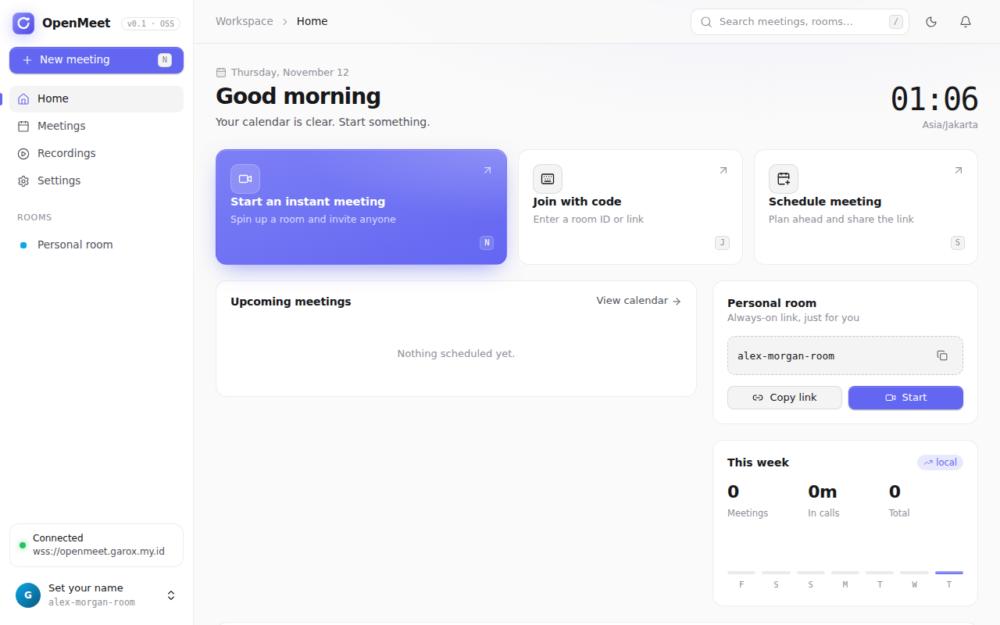
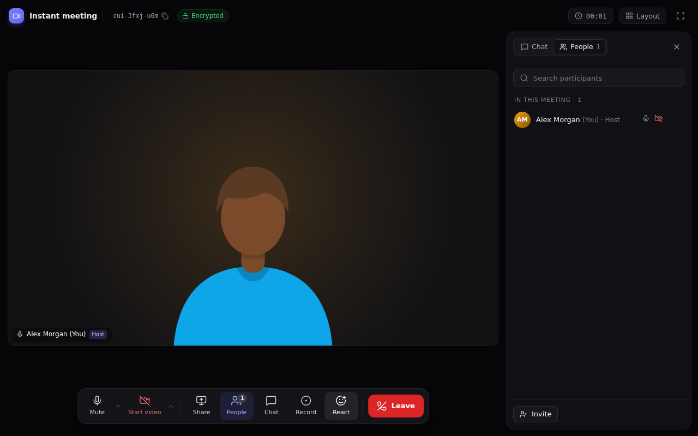

# OpenMeet

A free, self-hostable meeting app for desktop. Tauri 2 + Rust signaling + WebRTC.

OpenMeet is an independent project. It is not affiliated with, endorsed by, or compatible
with Zoom's proprietary protocol or services.

Try it: <https://openmeet.garox.my.id> (browser, no install) or build the desktop app below.

Backend can run on Render (Blueprint + Docker are in the repo): see
[docs/DEPLOYMENT-RENDER.md](docs/DEPLOYMENT-RENDER.md).



## What works today (v0)

- Dashboard: upcoming rooms, recent history, personal room, per-week stats, dark/light theme
  and five accent colors
- Scheduling: pick a time, get a pre-created room code, share the link. Stored in Neon
  Postgres when `DATABASE_URL` is set, otherwise locally in the browser (no email invites)
- Pre-join check: camera preview, mic level meter, device pickers, passcode field,
  noise suppression / echo cancellation toggles
- Room: gallery and speaker layouts, pin, active-speaker outline, mute/camera state,
  screen sharing (with system audio when the browser provides it), chat, participant list,
  reactions, raise hand, local recording (`webm` download), host can end the meeting
- SFU media through LiveKit when configured (25 participants on the reference instance), with
  automatic fallback to the peer-to-peer mesh
- Rooms are created with caller-chosen codes, so a scheduled or personal link keeps working
- Meeting history (SQLite), tray menu, notifications, `openmeet://join/<code>` deep links
- Web client served by the same Rust binary as the signaling service



Media runs on a LiveKit SFU when `LIVEKIT_URL`, `LIVEKIT_API_KEY` and `LIVEKIT_API_SECRET` are
set (reference instance: 25 participants); without them the client falls back to the
peer-to-peer mesh (best for 1:1 and 6–8 people). See
[docs/ARCHITECTURE.md](docs/ARCHITECTURE.md). Recording is local only (your mic plus camera or
screen, saved as `.webm`); server-side/cloud recording is still on the roadmap, which is why
the Recordings page stays empty.

## Quickstart

Prerequisites: Rust 1.85+, Node 20+, and the Tauri 2 Linux dependencies
(`libwebkit2gtk-4.1-dev`, `libgtk-3-dev`, `libayatana-appindicator3-dev`, `librsvg2-dev`,
`libxdo-dev`, `libssl-dev`, `libsoup-3.0-dev`).

### Use it in the browser

A public instance runs at <https://openmeet.garox.my.id>. Open the page, start a room, share
the link. No install, no account. Browser calls use the same mesh transport as the desktop app.

### 1. Signaling and web client

```bash
cargo run -p openmeet-signaling
# listening on 0.0.0.0:8770  (OPENMEET_BIND to override)
```

Health check: `curl http://127.0.0.1:8770/healthz`

The same binary also serves the web client when `OPENMEET_WEB_DIR` points at a built
frontend:

```bash
cd apps/desktop && npm run build
OPENMEET_WEB_DIR=dist cargo run -p openmeet-signaling
# web client: http://127.0.0.1:8770
```

### 2. Desktop app (dev)

```bash
cd apps/desktop
npm install
npm run tauri dev
```

Set the signaling URL in Settings. The default is the hosted instance
`wss://openmeet.garox.my.id`; point it at your own server when self-hosting. For two machines on
a LAN, use the server's LAN address, for example `ws://192.168.1.20:8770`.

### 3. Build

```bash
cd apps/desktop
npm run tauri build
```

Artifacts land in `apps/desktop/src-tauri/target/release/bundle/`.

CI builds the **Windows** installers (`.msi` and NSIS `.exe`) on every `v*` tag or manual run
of the `build` workflow; download them from the Actions run or the release page. Linux and
macOS builds are done locally (`npm run tauri build`) — see the notes above. Windows builds are
unsigned, so SmartScreen warns on first launch.

## Deployment

Signaling is stateless apart from in-memory rooms; run one instance per region and put TLS in
front of it (Caddy, nginx, Traefik). Media does not transit the server in mesh mode.

For calls across NATs, run the bundled TURN service:

```bash
cd deploy/coturn
cp .env.example .env      # set TURN_SECRET and EXTERNAL_IP
docker compose up -d
```

Then point the signaling server at it:

```bash
OPENMEET_TURN_URLS=turn:turn.example:3478?transport=udp,turn:turn.example:3478?transport=tcp \
OPENMEET_TURN_SECRET=<same secret as coturn> \
cargo run -p openmeet-signaling
```

Clients receive short-lived TURN credentials in the `welcome` message; no static relay
password is shipped in the app. See [docs/DEPLOYMENT.md](docs/DEPLOYMENT.md) for TLS, systemd
and firewall details.

## Repository layout

```
apps/desktop          Tauri 2 shell + React UI
  src/                UI, signaling client, WebRTC transport
  src-tauri/          Rust: tray, deep links, settings, SQLite history
crates/signaling      axum room/signaling service
deploy/coturn         TURN server (coturn) for self-hosting
docs/ARCHITECTURE.md  design, Zoom-parity analysis, security model, roadmap
docs/PROTOCOL.md      signaling wire protocol
docs/DEPLOYMENT.md    TLS, systemd, coturn, distribution
docs/DEPLOYMENT-RENDER.md  Render Blueprint, custom domain, caveats
render.yaml           Render blueprint (Docker web service)
Dockerfile            multi-stage build (web + Rust signaling)
```

## Security

The app loads only bundled assets, uses a static least-privilege capability set, and ships
no telemetry. Rooms are ephemeral; passcodes are hashed in memory and never logged. Please
report vulnerabilities privately (see `SECURITY.md`).

## License

Apache-2.0. See [LICENSE](LICENSE).

Third-party runtime components: Tauri (MIT/Apache-2.0), React (MIT), coturn (BSD-3-Clause).
Codec licensing is discussed in the architecture document; H.264 is intentionally not part
of the default stack.
